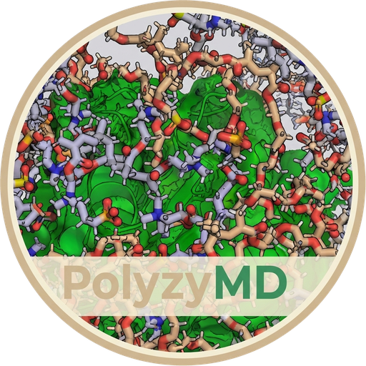

<p align="center">
  
</p>

<h1 align="center">PolyzyMD</h1>

<p align="center">
  <a href="https://github.com/joelaforet/polyzymd/actions/workflows/ci.yml"></a>
  <a href="https://polyzymd.readthedocs.io"></a>
  <a href="https://opensource.org/licenses/MIT"></a>
</p>

<p align="center">
  <strong>Build, run and analyze molecular dynamics of proteins, alone or with
  polymers, ligands and co-solvents, on OpenMM or GROMACS.</strong>
</p>

<p align="center">
  <a href="https://polyzymd.readthedocs.io">Documentation</a> ·
  <a href="https://polyzymd.readthedocs.io/en/latest/get_started/quickstart.html">Quickstart</a> ·
  <a href="https://polyzymd.readthedocs.io/en/latest/how_to/index.html">How-to guides</a>
</p>

## Install

PolyzyMD installs with [pixi](https://pixi.sh):

```bash
curl -fsSL https://pixi.sh/install.sh | sh        # if you don't have pixi
git clone https://github.com/joelaforet/polyzymd.git ~/polyzymd
cd ~/polyzymd
pixi install -e build
pixi shell -e build
polyzymd --help
```

For a GPU or a SLURM cluster, see
[Installation](https://polyzymd.readthedocs.io/en/latest/get_started/installation.html).

## How it works

1. **Prepare** a clean PDB, and the SMILES of your monomers.
2. **Configure** one `config.yaml` for each condition you compare.
3. **Build and audit.** Every build is checked against its config.
4. **Run** on OpenMM or GROMACS, on a laptop or a SLURM cluster.
5. **Analyze** each replicate, with uncertainty.
6. **Compare and publish**: statistics across conditions, and a frozen deposit
   of the study.

A *project* holds the studies of a paper, a *study* the conditions you
compare, and a *condition* its replicates.

## Quickstart

Simulate the protein Trp-cage in water and measure its radius of gyration,
in about 10 minutes on a laptop CPU:

```bash
polyzymd project init ~/pz_quickstart --study trpcage
cd ~/pz_quickstart
polyzymd study add-condition Water --config ~/polyzymd/examples/quickstart/config.yaml --study trpcage
polyzymd validate -c trpcage/conditions/water/config.yaml
polyzymd run -c trpcage/conditions/water/config.yaml -r 1

# In project.yaml, replace `analyses: {}` with `analyses: {rg: {}}`, then:
git add -A && git commit -m "Add the Water condition and the rg analysis"
polyzymd analyze --project .
```

The [Quickstart](https://polyzymd.readthedocs.io/en/latest/get_started/quickstart.html)
explains each step and its output.

## Next steps

| I want to | Read |
|---|---|
| Learn PolyzyMD step by step | [Tutorials](https://polyzymd.readthedocs.io/en/latest/tutorials/index.html) |
| Run on my NVIDIA GPU, or on a SLURM cluster | [Run on a GPU](https://polyzymd.readthedocs.io/en/latest/how_to/hardware_platforms.html), [Run on SLURM](https://polyzymd.readthedocs.io/en/latest/how_to/hpc_slurm.html) |
| Add polymers, a co-solvent or a ligand | [Polymers from SMILES](https://polyzymd.readthedocs.io/en/latest/how_to/dynamic_polymers.html), [Co-solvents](https://polyzymd.readthedocs.io/en/latest/how_to/cosolvents.html), [Ligands](https://polyzymd.readthedocs.io/en/latest/how_to/ligand.html) |
| Compare conditions, and publish | [Compare conditions](https://polyzymd.readthedocs.io/en/latest/how_to/analysis_compare_conditions.html), [Publish](https://polyzymd.readthedocs.io/en/latest/how_to/study_freeze.html) |
| Move from PolyzyMD 1.2 | [Rewrite a 1.2 config](https://polyzymd.readthedocs.io/en/latest/how_to/rewrite_config_rc5.html) |

## Cite

If you use PolyzyMD in published work, please cite it, with the version you
used. Each build also lists the methods it used, under "Methods to cite" in
its `build_provenance.md`.

```bibtex
@software{laforet_polyzymd,
  author = {Laforet, Jr., Joseph R.},
  title = {PolyzyMD: build, run and analyse molecular dynamics of complex biomolecular systems},
  version = {1.3.0},
  year = {2026},
  url = {https://github.com/joelaforet/polyzymd}
}
```

## License

MIT. See [LICENSE](LICENSE).
