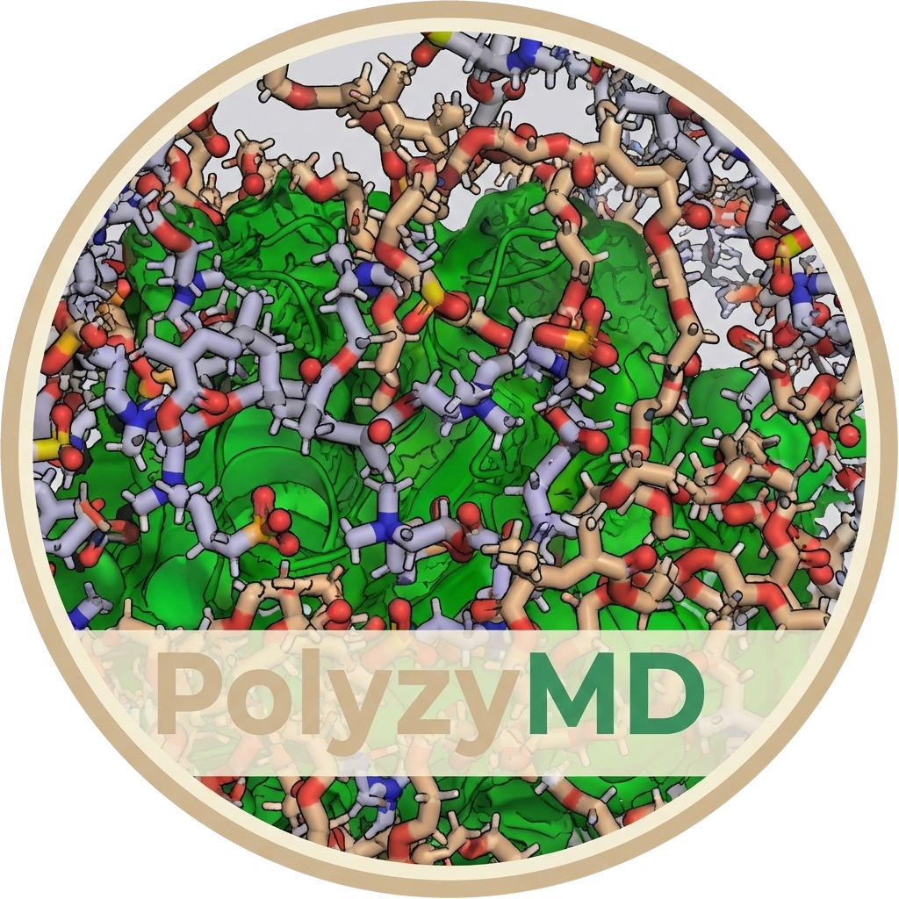

<p align="center">
  
</p>

<h1 align="center">PolyzyMD</h1>

<p align="center">
  <a href="https://github.com/joelaforet/polyzymd/actions/workflows/ci.yml"></a>
  <a href="https://www.python.org/downloads/"></a>
  <a href="https://opensource.org/licenses/MIT"></a>
</p>

<p align="center">
  <strong>Molecular dynamics simulation toolkit for enzyme-polymer systems.</strong>
</p>

<p align="center">
  <a href="https://polyzymd.readthedocs.io">Documentation</a> •
  <a href="#installation">Installation</a> •
  <a href="#quick-start">Quick Start</a>
</p>

---

## Overview

PolyzyMD builds, runs and analyzes molecular dynamics of a protein alone or
with a ligand, co-polymer chains and co-solvents. You describe each condition
in one `config.yaml`.

- **System building**: places the protein, a docked or crystal ligand and
  random co-polymer chains, and packs water, ions and co-solvents with
  PACKMOL. Each solute and the solvent name their own force-field files and
  charge source.
- **Physics audit and build record**: every build rebuilds each component
  alone with OpenFF and compares it term by term with the built system, and
  checks the system against the config (counts, ions, cutoffs, clashes,
  restraints, GROMACS `.mdp` files). The result goes into
  `build_provenance.json` and `build_provenance.md`, with the versions, seeds,
  file hashes and the methods to cite. `run` and `submit` start a replicate
  only from a build whose audit passed and whose config and files are
  unchanged. See
  [the physics audit](https://polyzymd.readthedocs.io/en/latest/explanation/physics_audit.html).
- **Simulation**: equilibration and production with OpenMM or GROMACS, on
  this machine or as self-resubmitting SLURM jobs.
- **Projects and studies**: a project holds the studies of one paper; a study
  holds conditions that share one analysis frame and one control. `study
  freeze` and `project freeze` prepare a deposit with hashes and citation
  files.
- **Analysis**: `polyzymd analyze` compares conditions across replicates and
  stores each result with the hashes of its inputs.

## Analysis Status

- Stable comparison and plotting workflows through `polyzymd analyze NAME -c config.yaml`: RMSD, Rg, RMSF, distances, secondary structure, SASA, native contacts, polymer-protein contacts and hydrogen bonds; the catalytic triad is a short routine on the same study API ([how-to](https://polyzymd.readthedocs.io/en/latest/how_to/analysis_triad_quickstart.html))
- Experimental analysis features have been removed from the active CLI surface until their definitions and interpretation are finalized
- Analysis supports both OpenMM (DCD) and GROMACS (XTC) trajectories via engine-aware trajectory resolution

## Installation

PolyzyMD uses [pixi](https://pixi.sh) for environment management. Pixi handles
all dependencies (OpenMM, OpenFF stack, CUDA, etc.) from conda-forge with
reproducible lockfiles.

### 1. Install pixi

```bash
curl -fsSL https://pixi.sh/install.sh | sh
```

### 2. Clone and install

```bash
git clone https://github.com/joelaforet/polyzymd.git
cd polyzymd
```

**For local use (building systems, validation, package work):**

```bash
pixi install -e build
pixi shell -e build
```

**For HPC clusters (GPU simulations):**

Pick the simulation runtime environment that matches your cluster's CUDA version:

| Cluster | CUDA | Environment |
|---------|------|-------------|
| CU Boulder Blanca | 12.4 | `sim-cuda-12-4` |
| PSC Bridges2 | 12.6 | `sim-cuda-12-6` |

```bash
# Example for Blanca:
pixi install -e sim-cuda-12-4
pixi shell -e sim-cuda-12-4

# Example for Bridges2:
pixi install -e sim-cuda-12-6
pixi shell -e sim-cuda-12-6
```

After `pixi shell`, the `polyzymd` command is on PATH and works normally.

`pixi run` and `pixi shell` look for `pixi.toml` in the current folder and
its parent folders. In a project folder outside the clone, they stop with
`could not find pixi.toml`. Give them the clone's `pixi.toml` with
`--manifest-path`:

```bash
pixi run --manifest-path ~/polyzymd/pixi.toml -e build polyzymd validate -c config.yaml
```

Or start `pixi shell -e build` once in the clone and then `cd` to your
project. The shell keeps its environment in every folder. To build in `build`
and run in a `sim-cuda-*` environment on the same machine, open one shell for
each environment, or use `--manifest-path`.

PolyzyMD v1.3 intentionally splits environments by workflow. Use `build` to
prepare systems, use `sim-cuda-*` only to run simulations on an NVIDIA GPU (a
cluster node or this machine, after `polyzymd build` in `build`), and
use `analysis` to compare trajectories and make plots. The same project files,
prepared systems, checkpoints, and trajectories move between these environments.
This split preserves CUDA 12.4 cluster support while keeping package and
analysis work on Python 3.12 with NumPy 2.

macOS is supported for non-CUDA setup, development, and trajectory analysis
where dependencies solve. The CUDA simulation environments are Linux-only and
intended for GPU clusters. AmberTools/AM1-BCC support is Linux-focused in the
pixi workflow; macOS users should use NAGL/OpenFF charging or pre-charged
molecules and open an issue if they need AmberTools support.

### How to find your CUDA version

Run on a GPU node:

```bash
nvidia-smi | head -1
```

The driver version in the top-right maps to a maximum supported CUDA version.
Use the environment whose CUDA version does not exceed your driver.

## Quick Start

### 1. Make a Project and a Condition

```bash
polyzymd project init my_paper --study my_protein
cd my_paper
polyzymd study add-condition "No polymer" --new --study my_protein
```

This makes a project folder with one study, and a template `config.yaml` in
`my_protein/conditions/no_polymer/`.

**Disk space:** the runs go into the git-ignored `runs/` folder of the
project unless you set `scratch_directory` in the config. Trajectories can
use a lot of disk space. On a cluster, set `scratch_directory` to scratch
storage.

### 2. Add Your Structure Files

```bash
cp /path/to/enzyme.pdb my_protein/conditions/no_polymer/structures/
cp /path/to/substrate.sdf my_protein/conditions/no_polymer/structures/  # optional
```

### 3. Edit Configuration & Run

```bash
cd my_protein/conditions/no_polymer
# Edit config.yaml with your settings, then:
polyzymd validate -c config.yaml
polyzymd build -c config.yaml -r 1 --dry-run
```

To add more conditions, go back to the project folder (`my_paper`) and run
`polyzymd study add-condition LABEL --from "No polymer" --study my_protein`.

`submit` does not build. Build each replicate first, in the `build`
environment. For a large system, run the build in a compute job, as the
[SLURM guide](https://polyzymd.readthedocs.io/en/latest/how_to/hpc_slurm.html)
shows:

```bash
polyzymd build -c config.yaml -r 1-5
```

Then run `polyzymd submit` from the `build` environment. The job script activates
the CUDA simulation environment on the compute node:

```bash
pixi shell -e build
polyzymd submit -c config.yaml --replicates 1-5 --preset blanca-shirts
polyzymd submit -c config.yaml --replicates 1-5 --preset bridges2
```

The `--preset` flag selects the SLURM settings and the pixi environment of
the job script (`sim-cuda-12-4` for Blanca, `sim-cuda-12-6` for Bridges2).
The default preset is `aa100` (CU Boulder Alpine). Other presets are `al40`,
`blanca-chbe-rdi` and `testing`; the
[SLURM guide](https://polyzymd.readthedocs.io/en/latest/how_to/hpc_slurm.html)
lists them all. You can override the environment with `--pixi-env`
(`auto`, `build`, `sim-cuda-12-0`, `sim-cuda-12-4` or `sim-cuda-12-6`):

```bash
polyzymd submit -c config.yaml --replicates 1-5 --preset bridges2 --pixi-env sim-cuda-12-6
```

See the [Quick Start Guide](https://polyzymd.readthedocs.io/en/latest/get_started/quickstart.html) for a complete walkthrough.

## CLI Commands

`polyzymd --help` lists every command, and `polyzymd COMMAND --help` its
options.

| Command | Description |
|---------|-------------|
| `polyzymd project init my_paper --study my_protein` | Make a project folder with one study |
| `polyzymd project add-study`, `check`, `freeze` | Add a study, check a project, freeze it for a deposit |
| `polyzymd study add-condition LABEL --new` | Add a condition with a template config |
| `polyzymd study init`, `check`, `locate`, `freeze` | Make, check, locate the runs of, and freeze a study |
| `polyzymd validate -c config.yaml` | Check a config and its input files |
| `polyzymd build -c config.yaml -r 1` | Build and audit a replicate; writes `build_provenance.md` |
| `polyzymd run -c config.yaml -r 1` | Build if needed and run on this machine (OpenMM or GROMACS) |
| `polyzymd submit -c config.yaml --replicates 1-5` | Submit self-resubmitting SLURM jobs |
| `polyzymd status -c config.yaml` | Show progress and job state of each replicate |
| `polyzymd recover -c config.yaml` | Resume a stalled or interrupted simulation |
| `polyzymd cancel -c config.yaml` | Stop self-resubmitting job chains |
| `polyzymd analyze NAME -c config.yaml` | Run one analysis and print a validated result |
| `polyzymd analyze --project my_paper` | Run every analysis of `project.yaml` in each study, or only `NAME` |
| `polyzymd clean-pdb -i protein.pdb` | Replace nonstandard residues and add hydrogens |
| `polyzymd analysis-topology`, `hash-trajectories` | Add `system.prmtop` or trajectory hashes to existing runs |
| `polyzymd info` | Show installation information |

## Pixi Environments

PolyzyMD uses [pixi](https://pixi.sh) instead of conda/mamba. Key differences:

- **No `conda activate`** — use `pixi shell -e <env>` instead
- **No environment YAML** — `pixi.toml` + `pixi.lock` are the single source of truth
- **Reproducible** — the lockfile pins every package to exact versions
- **CUDA-aware** — each environment pins the correct CUDA version

| Environment | Use case | Stack policy | Requires GPU? |
|-------------|----------|--------------|---------------|
| `build` | System building, PDB prep, validation, package work | Python 3.12 + NumPy 2 | No |
| `analysis` | Trajectory analysis, comparison, and plotting | Python 3.12 + NumPy 2 | No |
| `test` | CI/local tests and lint/docs tooling | Python 3.12 + NumPy 2 | No |
| `sim-cuda-12-0` | Simulation execution on CUDA 12.0 drivers (older Blanca nodes) | Python 3.12 + NumPy 1.x + OpenMM 8.1.x | Yes |
| `sim-cuda-12-4` | Simulation execution on CUDA 12.4 clusters (Blanca) | Python 3.12 + NumPy 1.x + OpenMM 8.1.x | Yes |
| `sim-cuda-12-6` | Simulation execution on CUDA 12.6 clusters (Bridges2) | Python 3.12 + current OpenMM | Yes |

AmberTools/AM1-BCC support is Linux-focused in PolyzyMD's pixi workflow and is
not part of the default v1.3 NumPy 2 build/analysis/test solve. Use NAGL/OpenFF
charging or provide pre-charged molecules; open an issue if you need a
dedicated AmberTools/AM1-BCC environment for a specific platform.

### Adding support for a new cluster

1. Determine the CUDA version (`nvidia-smi` on a GPU node)
2. Add a new `[feature.sim-cuda-X-Y]` block in `pixi.toml` following the existing pattern
3. Add the corresponding environment in `[environments]`
4. Add the preset mapping in `PRESET_DEFAULT_PIXI_ENV` in `slurm.py`
5. File a PR

## Documentation

Full documentation is available at **[polyzymd.readthedocs.io](https://polyzymd.readthedocs.io)**.

- [Quick Start Guide](https://polyzymd.readthedocs.io/en/latest/get_started/quickstart.html)
- [Installation Guide](https://polyzymd.readthedocs.io/en/latest/get_started/installation.html)
- [Configuration Reference](https://polyzymd.readthedocs.io/en/latest/reference/configuration.html)
- [HPC & SLURM Guide](https://polyzymd.readthedocs.io/en/latest/how_to/hpc_slurm.html)
- [API Reference](https://polyzymd.readthedocs.io/en/latest/api/overview.html)

## License

MIT License - see LICENSE file for details.

## Citation

If you use PolyzyMD in your research, please cite:

```bibtex
@software{polyzymd,
  author = {Laforet Jr., Joseph R.},
  title = {PolyzyMD: build, run and analyse molecular dynamics of complex biomolecular systems},
  year = {2026},
  url = {https://github.com/joelaforet/polyzymd}
}
```
